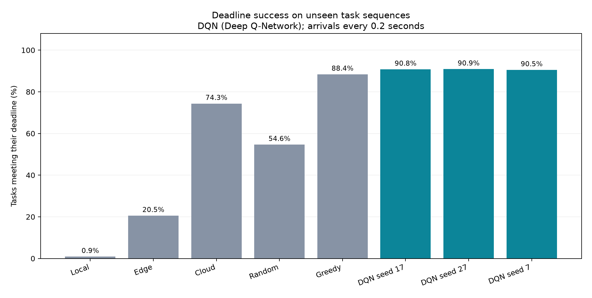

# Vehicle task offloading

Python simulation of vehicle task offloading across local, edge, and cloud resources, with reproducible experiments and policy comparisons.

The project implements DQN (Deep Q-Network) alongside fixed-location, random, and greedy policies. Inputs are synthetic numerical tasks, not collected vehicle measurements. Results describe the documented simulation, not real-road performance.

## Run on Windows

Use Python 3.12. In PowerShell, open this project directory. If the project environment does not exist, create it and install dependencies:

```powershell
py -3.12 -m venv .venv
.\.venv\Scripts\python.exe -m pip install -r requirements.txt
```

To try a supplied trained model immediately, run:

```powershell
.\.venv\Scripts\python.exe demo.py --model models/dqn_seed_7.pt --tasks 10
```

The table shows each task's inputs, selected destination, simulated completion
delay, deadline outcome, and reward. The default 10-task demonstration with
this checkpoint meets 9 deadlines; the benchmark below uses 3,000 tasks per
policy and provides the broader comparison. No retraining is needed for the demo.

To run the checks and reproduce the complete training and evaluation workflow:

```powershell
.\.venv\Scripts\python.exe -m unittest discover -s tests -v
.\.venv\Scripts\python.exe train.py --episodes 500 --seeds 7 17 27
.\.venv\Scripts\python.exe evaluate.py --episodes 30
```

Training uses the CPU (Central Processing Unit). The scripts locate their outputs relative to the project, so launching them from PyCharm also works. A new run using the same output location replaces that run's generated files; use the output-directory options to preserve separate experiments.

## Source files

| File | Purpose |
|---|---|
| `first_offloading_example.py` | Initial one-task latency exercise. |
| `environment.py` | Simulated clock and reserved processing slots for Local, Edge, and Cloud. |
| `baselines.py` | Reproducible task generation and five reference strategies. |
| `rl_environment.py` | RL (Reinforcement Learning) observations, actions, reward, and episode boundaries. |
| `config.py` | Training and experiment defaults. |
| `dqn_agent.py` | Neural network, exploration, replay memory, target network, learning, and checkpoint loading. |
| `train.py` | Training and validation-only checkpoint selection. |
| `evaluate.py` | Held-out policy comparison, numerical outputs, and figures. |
| `demo.py` | A short saved-model demonstration without training. |
| `tests/test_learning.py` | Checks for environment behavior and learning correctness. |

## Simulation assumptions

- One task is generated every 0.2 seconds. Each episode contains 100 tasks for training and evaluation.
- Input sizes are 0.5, 1.0, or 1.5 megabits. Required work is input size multiplied by 0.5, 1.0, or 2.0 billion processor cycles per megabit.
- Deadlines are 0.4, 0.8, or 1.2 seconds. Upload rates are 10, 20, or 40 megabits per second.
- Local, edge, and cloud capacities are 1, 5, and 10 billion processor cycles per second. Cloud communication adds 0.3 seconds.
- Processing slots are reserved in task-assignment order. A task starts after both its transfer and the previous reserved work finish.
- There is no explicit upload queue. In these settings the longest upload is 0.15 seconds, shorter than the 0.2-second task interval. Return transmission, mobility, failures, energy use, and competing external traffic are omitted.
- These numerical settings are illustrative experimental assumptions. They are not claimed to be measured vehicle specifications or copied from a particular study.

## Learning problem

The eight observation values are scaled task size, scaled required work, scaled deadline, scaled upload rate, three log-transformed remaining reserved times, and the fraction of tasks remaining. The observation contains the current task, not future task attributes. Processing capacities and the arrival interval stay fixed across the reported scenario.

Actions 0, 1, and 2 map to Local, Edge, and Cloud. The network is 8 -> 64 -> 64 -> 3, with ReLU (Rectified Linear Unit) between hidden layers and a linear output layer.

```text
reward = -(delay / 1 second) - 1 if the deadline is missed
reward = -(delay / 1 second)     otherwise
```

The deadline penalty is an explicit design choice. DQN (Deep Q-Network) estimates discounted future reward. A terminal transition uses only its immediate reward; it does not include a future-value term. The final task's calculated completion delay remains included even if it finishes after the last task arrival.

Experience replay stores past transitions. A periodically synchronized target network supplies fixed learning targets between synchronizations. Exploration decreases during training; evaluation disables exploration and parameter updates.

## Experiment outputs

The supplied models were trained for 500 episodes each with three different
random seeds. Each policy was evaluated on the same 30 held-out episodes of
100 tasks. See [the full summary](results/summary.csv) for unrounded values
and episode variability.

| Policy | Mean delay (seconds) | Deadlines met |
|---|---:|---:|
| Local | 49.156 | 0.9% |
| Edge | 2.308 | 20.5% |
| Cloud | 0.509 | 74.3% |
| Random | 4.303 | 54.6% |
| Greedy | 0.354 | 88.4% |
| DQN (Deep Q-Network), seed 7 | 0.332 | 90.5% |
| DQN (Deep Q-Network), seed 17 | 0.331 | 90.8% |
| DQN (Deep Q-Network), seed 27 | 0.332 | 90.9% |



All three models are reported rather than selecting one using test results.
The comparison holds for the documented synthetic workload and fixed system
settings; it does not establish performance on real vehicles or other workloads.

- `models/`: saved networks and settings for each training seed.
- `results/training_seed_*.csv`: per-episode training and validation records.
- `results/evaluation_results.csv`: per-policy, per-test-episode measurements.
- `results/summary.csv`: descriptive policy comparisons.
- `results/figures/`: plots for inspection, reports, and presentations.

The [model guide](models/README.md) explains checkpoint contents and loading.
The [results guide](results/README.md) explains table columns, figures, and the
distinction between demonstration, validation, and test outcomes.

Training traces use each training seed's designated stream. Validation uses seeds 1000000 through 1000009. Final evaluation begins at seed 2000000. The example using seed 42 is a learning exercise, not the final evaluation.

All policies receive identical external test inputs and fresh initial queues. Their decisions produce different queue histories. Checkpoints are selected using validation reward, never final-test performance. Every generated task counts toward the deadline-success rate. Repeated episode variability is descriptive; it should not be mistaken for independent evidence from real vehicles.

Greedy minimizes the current task's estimated delay. It is a strong baseline, and DQN (Deep Q-Network) is not guaranteed to outperform it. Report results and limitations honestly, including any disagreement between delay, deadline success, and reward.

## Background reference

[Deep Reinforcement Learning for Delay-Optimized Task Offloading in Vehicular Fog Computing](https://arxiv.org/abs/2410.03472) provides related simulation-based research. Its topology, algorithm, and numerical settings differ from this project; this implementation is not a reproduction of its results.
